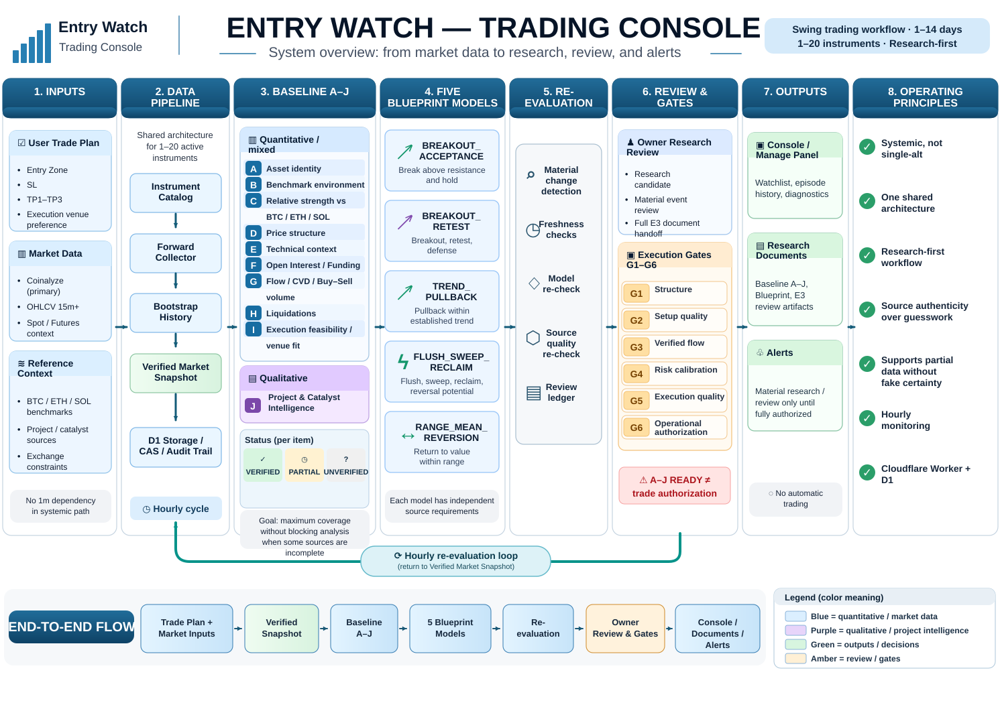

# Digital Product Lead · AI Product Builder

**Product Development · Quality Assurance · AI Operations · Creative Technology**

I build and improve real-world digital products with AI coding agents, combining product strategy, structured requirements, functional QA, and disciplined delivery. My work spans evidence-based knowledge systems, interactive science education, generative art, market-research tooling, and commercial web platforms.

**My role:** product vision and decisions, feature specifications, acceptance criteria, agent coordination, testing, release reviews, and ongoing improvement. AI coding agents support much of the implementation; I do not position myself as a traditional full-time software engineer.

---

## Selected products & projects

### 01 / Claim by Claim — Evidence & Knowledge Platform
**Live:** [claimbyclaim.com](https://claimbyclaim.com/)

An independent, evidence-first platform investigating misinformation, pseudoscience, conspiracy theories, and viral claims. It connects claims, investigations, evidence, original sources, and educational resources, so readers can follow the reasoning rather than simply trust a verdict.

- 200+ published investigations; structured knowledge model and connected learning content.
- Research and editorial workflows, source traceability, search/discovery, and a visual Knowledge Graph.
- **Stack:** Astro, JavaScript/TypeScript, GitHub, Cloudflare Pages and Pages Functions.
- **My contribution:** product conception, knowledge architecture requirements, editorial workflow design, AI-assisted delivery, QA, and production release decisions.

### 02 / Solar System Explorer — Interactive Astronomy & EdTech
**Live beta:** [Explore the Solar System](https://claimbyclaim.com/solar.system/)

An interactive educational experience for understanding astronomical scale — from planets and the outer Solar System to nearby stars.

- 2D/3D views and linear/logarithmic distance modes.
- Comparisons of physical distances, light-travel time, and hypothetical journey durations.
- Scientific context with explicit distinctions between measured data, approximations, and artistic visualisation.
- **Focus:** educational UX, visual explanation, user controls, and QA of complex interactive behaviour.

### 03 / Hidden Dimension — Generative Art Environment
**Live:** [Hidden Dimension](https://claimbyclaim.com/hidden.dimension/)

An interactive creative environment for exploring light, motion, form, and matter through real-time visuals.

- **[Space Lab](https://claimbyclaim.com/hidden.dimension/space-lab/)** — 12 astrophysics-inspired generative scenes; controls for exploring and exporting original still artwork.
- **[Fluid Lab](https://claimbyclaim.com/hidden.dimension/fluid-lab/)** — experimental, evolving creative workbench for liquid-like flows, smoke, colour and thermal effects. **Public experimental build / in development**, not a validated physics simulation.
- **Focus:** creative technology, WebGL/GPU visuals, interaction design, iteration, visual QA, and performance-aware experimentation.

### 04 / Crypto Entry Watch — Trading Research Console
**Status:** private R&D / phased production implementation

A research-first trading console for monitoring crypto-market conditions, structuring potential entry setups, and supporting disciplined human review. It is a decision-support system, **not an autonomous trading engine**.

*Target architecture overview — planned end-to-end operating model; individual components are at different stages of implementation.*

- **Shared data pipeline:** 1–20 active instruments, market-data ingestion from price, spot/futures and liquidity sources, verified snapshots, audit-friendly storage, and an hourly re-evaluation cycle.
- **Structured baseline A–J:** quantitative and qualitative research covering asset identity, benchmark environment, relative strength, price structure, technical context, open interest and funding, order-flow/CVD, liquidations, execution feasibility, and project/catalyst intelligence.
- **Five scenario blueprints:** Breakout Acceptance, Breakout Retest, Trend Pullback, Flush Sweep Reclaim, and Range Mean Reversion. Each has its own source requirements and validation context.
- **Re-evaluation and review:** freshness and material-change checks, model re-checks, source-quality assessment, and operator research review.
- **Six execution gates (G1–G6):** structure, setup quality, verified flow, risk calibration, execution quality, and operational authorization. Baseline readiness does not imply trade authorization.
- **Operator outputs:** management console, watchlist and episode history, diagnostics, versioned research documents, and review-oriented alerts.

**Stack:** Cloudflare Workers, D1, GitHub, JavaScript, market-data API integrations, and automated quality checks.

**My contribution:** product conception and architecture, system specifications, AI-assisted development oversight, data-integrity and QA methodology, observability, human-in-the-loop review design, release validation, and phased production planning.

*Private project: source code, operational endpoints, configurations, and internal research artifacts are not published in this profile.*

### 05 / TechMac — Commercial Website & Business Workflows
**Live:** [techmac.pl](https://techmac.pl/)

A real business platform supporting Apple product sales, refurbished equipment, technical service, customer enquiries, and financing workflows. TechMac also reflects my long-term experience in technical support and QA since 2010.

- Product catalogues and responsive interfaces for browsing Apple hardware.
- Leasing calculator integration and customer enquiry journeys.
- **Stack:** WordPress, PHP/Twig, ACF, MySQL, JavaScript, GitHub-based development and deployment workflows.
- **Focus:** product ownership, commercial UX, customer journeys, technical QA, SEO, and release verification.

---

## How I work with AI coding agents

| Stage | My responsibility |
| --- | --- |
| **Discover & define** | User problems, product goals, scope, requirements and acceptance criteria |
| **Plan & implement** | Break down work, coordinate coding agents, review decisions and manage changes |
| **Verify** | Functional tests, edge cases, regression checks, build/CI evidence and QA follow-up |
| **Release & improve** | Deployment gates, release reviews, observability, feedback and iteration |

I distinguish **functional verification** from **deep code review**: when implementation-level security, architecture, or algorithmic questions require specialist validation, I do not claim that product QA alone resolves them.

## Fields & tools

**Product & quality:** Product Discovery · Product Development · Product Ownership · QA · Acceptance Criteria · Regression Testing · Release Management

**AI & data:** AI Coding Agents · AI Operations · Research Workflows · Data Validation · API Integrations · Automated Monitoring

**Technology used across projects:** GitHub · Git/PRs · GitHub Actions · Cloudflare Pages/Workers/D1 · Astro · JavaScript/TypeScript · Three.js/WebGL · WordPress/PHP · SQL

**Domains:** Evidence & Knowledge Platforms · EdTech · Creative Technology · Interactive Visualisation · Market Research Systems · E-commerce & IT Services

---

## Explore the work

- [Claim by Claim](https://claimbyclaim.com/) — evidence-first research and knowledge platform
- [Solar System Explorer](https://claimbyclaim.com/solar.system/) — interactive astronomy and distance education
- [Hidden Dimension](https://claimbyclaim.com/hidden.dimension/) — generative-art environment, Space Lab and Fluid Lab
- [TechMac](https://techmac.pl/) — business website, commerce, support, and financing journeys

> **Product thinking + independent QA + AI-assisted implementation.** My goal is to ship useful, understandable software with verifiable outcomes.
